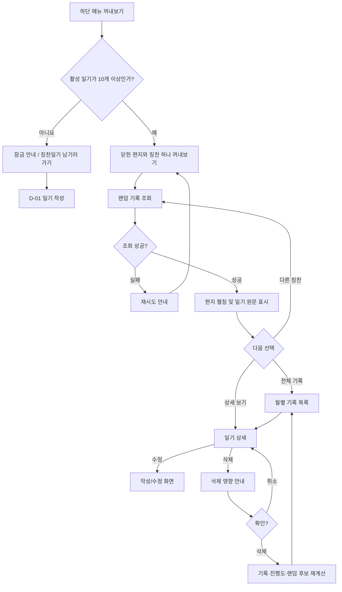

# L-01~L-04 ‘꺼내보기’ 화면 상세 UX 명세 v1.2

> 서비스 의도: “과거의 내가 스스로 칭찬했던 순간을 다시 읽으며, 내 안의 좋은 점을 스스로 발견한다.”  
> 화면명 **‘꺼내보기’는 임시 이름**이며 최종 네이밍 미확정.  
> 설계 상태: 구조/사용자 목적은 대화에 근거, 세부 플로우는 **제안**으로 표시.

## 1. 경험 원칙

1. ‘쌓아둔 기록을 찾아보는 저장소’보다 ‘내가 해냈던 순간을 우연히 만나는 행동’에 초점을 둔다.
2. 사용자가 직접 쓴 원문을 그대로 보여준다. AI 평가, 자동 생성 자기칭찬, 과도한 감정 단정은 하지 않는다.
3. 긴 문구/알고리즘 안내/분류명은 숨긴다. 사용자는 꺼내기, 다른 것 꺼내기, 전체 기록 보기만 알면 된다.
4. 처음 방문하고 기록이 없을 때는 억지로 편지 모양 가짜 기록을 보여주지 않는다.
5. 같은 날짜에 여러 기록이 있어도 각각 독립적인 추첨 후보(`entry_id`)로 다룬다. **[확정]**
6. 꺼내보기 기능은 활성 일기 10개 이상부터 열린다. 잠금 상태에서는 안내 문구와 일기 작성 CTA만 중심적으로 제공한다. **[확정]**
7. 일기 상세에서 삭제 시 날짜의 마지막 기록 여부에 따라 월별 그래픽 변화 안내를 적용한다.

## 2. 화면 분해와 진입 경로

| ID | 화면 | 진입 | 이탈/연결 |
|---|---|---|---|
| L-01-LOCK | 잠금 안내 | 하단 메뉴/홈 보조 CTA, **해제 이력 없고** 활성 일기 10개 미만 | D-01 작성, 홈 |
| L-01 | 꺼내보기 홈 | 하단 메뉴/홈 보조 CTA, 잠금 해제 상태 | L-02, L-03, 홈 |
| L-02 | 뽑은 칭찬 읽기 | L-01의 메인 CTA / ‘다른 칭찬’ | L-01, L-04, L-03 |
| L-03 | 모든 칭찬 목록 | L-01 또는 L-02의 보조 CTA, 도감 특정 월 | L-04, L-01, 도감 |
| L-04 | 일기 상세 | L-03 기록 선택, L-02 상세보기 | D-01 수정, 삭제 확인, 이전 화면 |

**제안:** L-01 → L-02는 꼭 새 라우트일 필요 없다. 같은 화면 내 ‘닫힌 상태→열린 편지 카드’ 전환이 더 자연스러울 수 있다. 화면 ID는 상태 분리/QA를 위해 유지한다.

## 3. L-01 화면 구조 [제안]

**헤더:** ‘꺼내보기’ / 보조 설명 한 줄 (“이전에 남긴 칭찬을 하나 꺼내볼까요?”)

**메인 영역:** 닫힌 편지 또는 작은 종이 꾸러미처럼 ‘아직 열지 않은 기록’을 시각화. 실제 기록 개수/유형/추첨 알고리즘 노출 불필요. 메인 CTA: “칭찬 하나 꺼내보기”.

**보조 영역:** “모든 칭찬 보기” → L-03. 과거 뽑은 기록 저장/즐겨찾기/AI 해석 등은 MVP 제외.

**하단:** 공통 내비게이션(홈, 꺼내보기, 도감, 설정).

**UI 비노출 내부 정보:** 기록 인덱스, random seed, 카테고리, 추첨 제외 사유, 서버 조회 상태 코드.

### 잠금/해제 상태 [확정]

| 상태 | 조건 | 사용자 노출 | CTA |
|---|---|---|---|
| L01-LOCK | **해제 이력 없고** 활성 일기 0~9개 | '나에게 남겼던 칭찬 중 하나를 되새겨볼 수 있는 공간이에요. 남겨진 칭찬이 많아지면 볼 수 있어요.' | '칭찬일기 남기러 가기' → D-01 |
| L01-READY | 최초 10개 달성하여 해제 이력 보유(이후 현재 개수 무관, 단 후보 1개 이상) | 닫힌 편지/그래픽 및 짧은 설명 | '칭찬 하나 꺼내보기', '모든 칭찬 보기' |
| L01-EMPTY | 해제 이력 존재, 활성 일기 0개 | ‘지금은 꺼낼 칭찬이 없어요’ 및 작성 CTA |
| L01-ERR | 조회 오류 | 잠금 여부를 추측하지 않음, 간결한 오류 안내 | '다시 시도' |

- **[확정]** 기준은 **서로 다른 작성일 수가 아닌 개별 일기 수**이다. 같은 날 10개를 작성해도 10개로 센다.
- **[제안]** 현재 활성 일기를 기준으로 처음 해제 상태를 계산하고, 최초 해제 이력은 별도 저장할 수 있도록 준비한다.
- **[확정] 한 번 해제하면 일기 삭제로 9개 이하가 되어도 재잠금하지 않는다.** 처음 해제한 서버 시각 `letter_draw_unlocked_at`을 저장하고 이후 수정/삭제로 되돌리지 않는다. 전체 사용자 기록 삭제 시 해제 이력도 삭제한다.
- **[확정에서 도출된 상태]** 해제된 상태에서 유효 일기 0개면 ‘꺼낼 칭찬이 없어요’로 안내하고 작성 CTA를 제공. 1개면 그 1개를 보여주고 ‘다른 칭찬 꺼내기’는 숨긴다.
- **[제안]** 잠금 화면은 숫자/진행바 없이 문장과 CTA 중심. 실제 정확한 10개 조건의 UI 노출 여부는 UX Writing 단계에서 결정.
- **[확정]** L-03 전체 일기 목록은 H-01 홈의 독립적인 ‘내가 남긴 칭찬 보기’ 경로로도 접근한다. 꺼내보기 잠금은 랜덤 기능만 제한하며 조회·수정·삭제 권한과 무관하다. 꺼내보기 잠금 안내 화면에서는 목록 CTA를 노출하지 않음.

## 4. L-02 뽑은 칭찬 읽기 [제안]

**오픈 전:** 닫힌 편지 표상 + 명확한 버튼. 닫힌 상태의 3D 모션은 선택, 보조 접근성 경로는 버튼 필수.

**추첨 후:** 날짜(예: “2026년 12월 14일의 내가 쓴 칭찬”), 제목(있을 때만), 본문 원문(줄바꿈·한글 그대로), 작은 움직임/서서히 펼침. ‘내가 잘한 점’을 강제로 해석·요약하지 않음.

**액션:**
- “다른 칭찬 꺼내기” (후보가 2개 이상일 때)
- “전체 기록 보기” (L-03)
- “이 일기 자세히 보기” (L-04, 편지 카드와 별도 상세가 필요할 때)
- 뒤로가기/홈/도감.

**전환:** 버튼 터치→랜덤 결과 수신→간단한 편지 펼침 연출→본문 공개. 렌더링 실패 시 텍스트만 즉시 노출. 사용자가 움직임 줄이기를 택하면 페이드 전환만 사용.

**길이가 긴 일기:** 카드 내부 잘림 금지. 본문 스크롤 또는 별도 상세로 자연스럽게 확장. 키보드 없이 읽을 수 있어야 함.

### 카피 예시 (가안)
- 제목: “그날의 내가 남긴 칭찬”
- CTA: “칭찬 하나 꺼내보기”, “다른 칭찬 꺼내기”
- 제목 없는 본문: 제목 영역을 비우고 본문만 표시
- 안내문 과다 노출 금지: 불필요한 ‘당신은 소중한 사람’류의 AI 생성 훈계 문구 없이 원문 중심

## 5. 랜덤 추첨 엔진 [확정 + 보류 구분]

**[확정] 최초 해제 조건:** 사용자의 활성 일기 개수 **10개 이상**. 날짜별 인정일 수와 독립. **한 번 열린 기능은 이후 삭제로 현재 개수가 줄어도 계속 열림.**

**[확정] 추첨 단위:** 개별 일기의 고유 ID(`entry_id`). 같은 날짜에 3편을 쓰면 **3개 독립 후보**이며, 날짜 우선 추첨으로 한 날짜를 하나의 후보로 묶지 않는다. 삭제한 기록은 후보에서 제외.

**[제안] 기본 추첨:** 해제 후 활성 일기 전체에서 개별 ID별 균등 추첨. 최근 뽑은 3개 제외는 후보가 충분할 때만 적용. ‘과거의 나’를 만나는 경험을 위해 오래된 기록 우선 방식을 시도할 수 있으나, **10개가 모두 오늘 작성되었더라도 열리지 않는 문제가 생기지 않도록** 신규 기록 제외 규칙은 아직 적용하지 않는다.

**[보류]:** 작성 후 경과시간에 따른 추첨 우선권; 개별 일기별 동일 확률을 최종 확정할지; 최근 반복 회피 정책; 세션 내 같은 결과 유지 여부.

**데이터 검증:** 후보는 서버에서 해당 사용자의 활성 일기만 조회하고, 선택한 일기가 여전히 존재하는지 결과 전달 전에 검증한다.

## 6. L-03 전체 칭찬 목록 [제안]

- 상단 ‘모든 칭찬’ + 월별 또는 연월별 그룹.
- 한 달에 여러 날짜, 하루 여러 일기: 각 글은 독립 행으로 표현. 날짜 그룹 밑에 해당 날짜 일기를 배열할 수 있음.
- 행: 날짜, 제목(없는 경우 본문 앞부분), 원문 일부, 누르면 L-04.
- 긴 목록: 페이지네이션/무한스크롤, 사용자별 필터. 검색은 MVP에서 필수 아님.
- 빈 상태: “아직 남긴 칭찬이 없어요.”와 작성 CTA.
- 특정 도감 월에서 진입할 때 그 월의 일기를 필터링한 채 시작할 수 있음.
- 사용자에게 내부 상태값/질문 분류명 노출 금지.

## 7. L-04 상세·수정·삭제 [확정 정책 연결]

- 기록 날짜/제목(선택)/본문 원문/작성 시각 메타데이터(표시 필요성은 추후 결정).
- ‘수정’ → D-01 기존 기록 수정. 수정할 때 작성일 수 변경 없음.
- ‘삭제’ → 해당 날짜의 활성 일기가 남는지 서버에서 확인 후 구분된 경고 문구 표시:
  - 남으면 “이 일기를 삭제하면 그래픽에서 해당 글자가 사라져요.” / 인정일 수 유지.
  - 마지막 기록이면 “이 일기를 삭제하면 12월의 눈꽃이 조금 녹아요.” 또는 “이 일기를 삭제하면 1월의 붉은 양이 조금 작아져요.” + “이번 달 작성일 수가 1일 줄어들어요.”
  - 목표 미달로 내려가면 완성 상태 해제도 명확히 고지.
- 삭제 완료 후 L-03 목록·L-01 랜덤 후보·해당 월 그래픽/도감 동기화.
- 사용자가 읽던 랜덤 기록을 삭제하면 즉시 L-02에서 제거하고 다른 기록 꺼내기 또는 빈 상태로 전환.

## 8. 대표 사용자 플로우

## 9. 요청 데이터/API 스케치 [제안]

- `GET /me/letterbox/summary` → `totalEntries`, `isUnlocked` (해제 이력 기준), `eligibleCount`, `lastDraw?` (목록 원문은 요청하지 않음)
- `POST /me/letterbox/draw` → `entryId`, `entryDate`, `title?`, `body`, `drawnAt`, `hasAlternative` (조건/후보 검증은 서버)
- `GET /me/diaries?month=YYYY-MM&page=...` → 일기 목록 요약
- `GET /me/diaries/:entryId` → 상세 원문
- `PATCH /me/diaries/:entryId` → 원문 수정, 그래픽 리비전 재계산
- `DELETE /me/diaries/:entryId` → 삭제 전 영향 조회/삭제 후 결과 반환

**안전:** 사용자 인증키 확인, 일기 소유자 검증, 서버 랜덤 샘플링, 삭제된 일기 제외, 데이터 로그에 제목/본문 노출 금지.

## 10. QA 수용 기준

1. 활성 일기가 0~9개일 때 잠금 안내와 “칭찬일기 남기러 가기” CTA가 보인다.
2. 같은 날짜에 작성한 일기 10개만 있어도 해제 조건을 충족하며 각각 독립된 랜덤 후보가 된다.
3. 질문 분류, 추첨 알고리즘, 내부 상태값이 UI에 보이지 않는다.
4. 질문을 선택하지 않고 쓴 일기도 동일하게 무작위 추첨 대상이 된다.
5. 같은 날짜의 여러 일기는 개별 원문과 ID로 조회·추첨할 수 있다.
6. 임의 추첨 결과는 실제 사용자 본인의 삭제되지 않은 일기다.
7. 긴 글이나 제목이 없는 일기도 본문이 잘리지 않는다.
8. 다시 뽑기 시 가능한 범위에서 바로 이전 편지 반복을 피한다(정책 확정 후).
9. L-02에서 열린 편지를 삭제하면 다시 열어도 노출되지 않는다.
10. 삭제 이후 해당 월 인정일 수·그래픽 높이·도감·기록 목록이 모두 일치한다.
11. 사용자별 하루 경계(기본 자정)를 기준으로 ‘과거 기록’ 후보 조건을 일관되게 적용한다.
12. 네트워크 실패 시 잘못된 일기가 표시되거나 성공으로 오인시키지 않는다.
13. 탭/뒤로가기 전환 이후 사용자 문맥(열린 편지)이 의도대로 유지된다.
14. 움직임 줄이기/스크린리더/큰 글씨에서도 읽기와 다시 뽑기가 가능하다.

## 11. 이 화면을 출시 전에 결정할 질문

- [OPEN-05] 랜덤 꺼내기는 ‘어제 이후 기록’부터 허용할지, ‘실제 저장하고 24시간 경과한 일기’부터 허용할지?
- [OPEN-06] 독립 후보로 관리하되 일기별 동일 확률로 할지 또는 오래된 기록에 가중치를 줄지?
- [OPEN-07] 최근 몇 개를 중복 제외할지? 후보 1~2개일 때 빈 상태를 어떻게 처리할지?
- [OPEN-13] 꺼낸 편지를 화면에서 바로 펼쳐 보여줄지, 별도 전체화면 L-02를 사용할지?

현재 기획 추천안은 **'꺼내보기 홈 → 편지 한 장 열림(동일 화면 상태 변화) → 필요할 때만 전체 목록/상세 이동'**이다. 사용자 승인 전까지 확정 처리하지 않는다.

- [확정] 최초 10개 달성 후 9개로 줄어들어도 잠금 재적용하지 않음.
- [OPEN-14] 잠금 상태에서 자신의 일기 목록/수정/삭제로 접근하는 별도 경로는 무엇인지?

### 변경 이력 v1.1
- 사용자 확정: 10개 이상 누적시 꺼내보기 잠금 해제, 잠금 문구/작성 CTA, 같은 날짜 다수 일기의 개별 추첨 후보화.
- 이전에 제안한 0~1개에서의 랜덤 오픈, 날짜 우선 균등 추첨을 기본안에서 제거.

### 변경 이력 v1.2
- **확정:** 최초 10개 일기로 열린 꺼내보기는 이후 삭제로 10개 아래가 되어도 계속 이용 가능. 해제시각을 영구 상태로 저장(서비스 전체 삭제시 제외).
- 빈 후보 수 0개인 해제 계정은 잠금 화면이 아닌 별도의 빈 상태 표시, 1개인 경우 다시 뽑기 숨김.

## v1.6 변경: 기록 조회 경로 분리 [확정]
- 홈 H-01 → L-03 전체 일기 목록으로 이동하는 독립 진입점을 제공한다.
- 꺼내보기 L-01은 일기 10개 최초 달성 시 영구 해제되는 랜덤 회고 기능이며, L-03의 기존 일기 조회·수정·삭제에는 잠금 조건을 적용하지 않는다.
- 홈의 그래픽 짧은 터치는 확대 감상(G-03)을 유지하고, 길게 누르기는 사용자 접근성/발견성 때문에 유일한 목록 진입 제스처로 사용하지 않는다. 그래픽 아래 저위계 텍스트 액션을 추천 [제안].
