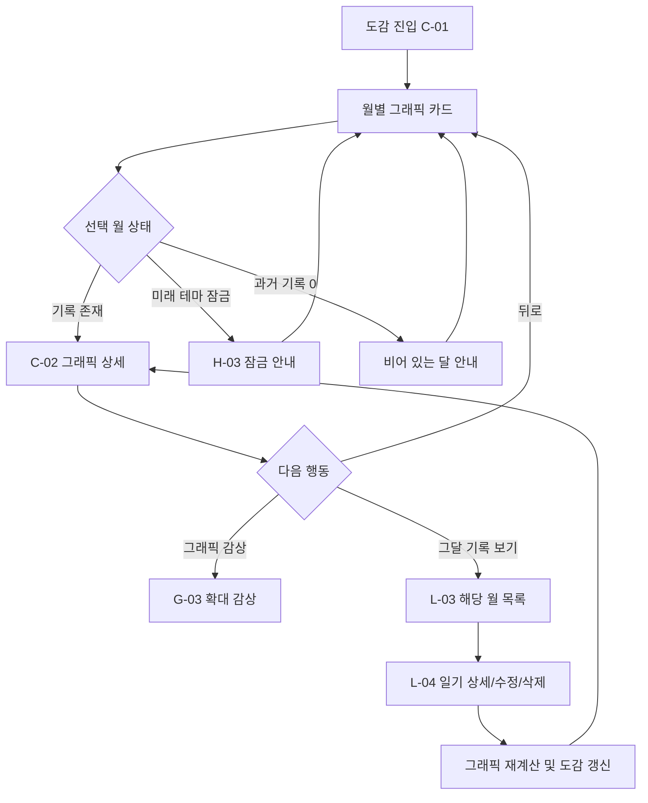

# C-01~C-02 그래픽 도감 UX 상세 명세 v1.3

> 기준 2026-11-21. **사용자 확정**: 월별 완성·미완성 그래픽을 모두 보관/감상, 2026-12 눈꽃 / 2027-01 붉은 양과 해, 이후 미래 테마 잠금, 큰 진행바 없이 그래픽이 아래→위로 채워짐. 이 문서에서 **2열 카드형은 사용자 확정**, 세부 스타일·화면 경로 및 데이터 모델은 별도 표기한 범위에서 제안.

## 1. 도감 목표
- 홈(H-01)은 현재 월의 성장, 도감(C-01)은 과거 월들의 그래픽을 한데 모아 감상하는 자리.
- 달성 여부를 성공/실패의 평가로 보여주지 않는다. 5일만 써도 그때까지 생성된 그래픽 자체를 보관.
- 그래픽 중심 탐색; 달력/진행바가 중심이 되지 않으며 일기 원문 목록은 필요할 때 L-03으로 연결.

## 2. IA/화면 ID
| ID | 역할 | 진입 | 연결 |
|---|---|---|---|
| C-01 | **2열** 월별 그래픽 도감 [확정] | 글로벌 내비게이션/홈/완성 후 | C-02, C-03, H-01 |
| C-02 | 특정 월 그래픽 상세 및 그달 일기로 가기 | C-01 월 카드, H-02 월 선택, G-01 완성, G-02 과거 월 | L-03 월 필터, C-01, H-01(현재 월) |
| C-03 (H-03 재사용 가능) | 미래 미공개 그래픽 안내 + 낮은 위계의 제안하기 링크 | C-01 미래 월 카드 | C-01, C-04 |
| C-04 | 원하는 그래픽 모양 의견 입력 [추가기능] | C-03의 보조 텍스트 액션 | C-03 |
| L-03 | 월별 일기 목록(필터 적용) | C-02 ‘이달의 칭찬 보기’ | L-04 개별 기록 |

- 기존의 G-02(지난달 상세)와 C-02는 별도 UI를 중복 개발하지 않고 `MonthlyGraphicDetail`을 공용 사용한다. G-02는 유입 경로/라우트 별칭.
- 도감의 그래픽 확대/회전은 G-03 렌더러/감상 컴포넌트 재사용 [제안].

## 3. C-01 기본 레이아웃 [2열 확정, 상세 제안]
1. 상단 제목: **‘나의 그래픽 도감’**. 짧은 설명은 최초 1회 또는 필요시.
2. **2열 월별 카드 [확정]**(반응형 세부는 추후 검증). 시각 비중: 그래픽 크게 → 월/이름 → 작은 작성일 수.
3. 미완성은 진행 중인 실제 부분 그래픽을 보여준다. 미완성 배지, 실패 문구, 큰 수치 바 금지.
4. 미래 미공개는 실제 완성 그래픽을 스포일러하지 않고 잠금 실루엣 또는 일반적인 잠금 표상으로 표시. **카드 자체는 C-03 잠금 안내에 연결하고, 의견 제안 링크는 C-03의 낮은 위계에 둔다 [확정: 의견 제안/낮은 위계, 화면 배치는 제안].**
5. 아직 사용자가 기록하지 않은 과거 월은 ‘빈 달’로 표시(미래 잠금과 다르게 취급).
6. 순서는 최근 월 우선이 기본안. 연도 필터는 12개월 이상 기록이 쌓일 때 도입할 수 있도록 구조만 준비.
7. 하단 내비게이션 구조는 추후 디자인시스템 단계 확정.

## 4. 월별 상태 구분
| 내부 상태 | 판정 | 보이는 화면/행동 |
|---|---|---|
| 현재 월·성장 중 | 테마 공개, 작성일 1~목표-1 | 진행 중인 그래픽, 상세 진입 가능 |
| 현재/과거 월·완성 | 작성일 ≥ 목표 | 완성 그래픽, 상세 진입 가능 |
| 과거 월·미완성 | 과거 월, 작성일 1~목표-1 | 완성되지 않은 부분 그래픽, 상세 진입 가능 |
| 과거 월·기록 0 | 과거 월, 유효 일기 0 | 기록 없는 달, 상세/작성 진입 방식은 추후 결정 |
| 미래 월·잠금 | 달이 아직 오지 않았거나 테마 미공개 | 잠금 카드, H-03 안내. 미래 날짜 작성 불가 |
| 현재 월·테마 준비 중 | 현재 월이지만 에셋 미공개 | 기록할 수 있는 임시 안내 + 홈/일기 쓰기, 그래픽은 준비 중 [제안] |
| 그래픽 로딩 실패 | 네트워크/렌더 실패 | 정적 폴백 또는 재시도; 일기 자체 접근 유지 |

주의: 날짜·월 판정은 사용자별 서비스 날짜 경계(기본 KST **00:00**)를 따른다. 새 달로 넘어가도 '어제' 기록 추가가 가능하며 작성 중 유예가 있으므로, 달말이 지나도 직전 월의 그래픽을 즉시 불변으로 고정하지 않는다.

## 5. C-02 월별 상세 [제안]
- **상단:** 뒤로, 월, 테마 이름(예: ‘12월의 눈꽃’).
- **중심:** 현재 유효 기록으로 재구성된 글자 파티클 그래픽. 홈의 월간 렌더러 사용, 필요시 확대 감상.
- **보조:** 작은 작성일 수(예: ‘8일의 칭찬’), 상태별 짧은 문장. 미완성에 부정적인 문구 금지.
- **CTA:** ‘이달의 칭찬 보기’ → L-03으로 해당 `year_month` 필터와 출발 화면 맥락 전달.
- **과거월:** 새 일기 추가는 금지(기존 D-01 ‘어제’ 정책이 별도로 허용하는 최신 날짜만 예외); 기존 일기는 L-04에서 수정/삭제 가능(수정 날짜 변경은 미확정).
- **현재월:** 홈으로 돌아가 ‘오늘의 칭찬 남기기’ 가능.
- **완성 여부는 그래픽 상태/메시지로 표현하고 큰 배지로 과시하지 않는다.**

## 6. 사용자 여정

## 7. 데이터와 계산 [제안]
- `MonthCatalog(year_month, target_days, status, release_at?)` + `ThemeOptions(theme_id, year_month, name, asset_version, status, render_config, sort_order)`; 동일 월에 여러 테마 옵션 허용
- `MonthlyProgress(user_id, year_month, written_days, total_entries, graphic_revision)` = 일기 원본 기반 계산/캐시. 사용자의 선택 테마는 `UserMonthGraphicSelection(user_id,year_month,theme_id,selected_at)`에서 참조.
- `DiaryEntries(entry_id, user_id, entry_date, body, deleted_at?)`; 동일 날짜 복수 ID 허용.
- `MonthlyGraphicSnapshot`을 쓰더라도 불변 픽셀 이미지 하나에만 의존하지 않는다. 렌더 고정 시드·에셋 버전을 보관하여 동일 월을 재현.
- 컬렉션 카드 조회는 월 메타데이터/진행도/에셋 참조만 요청하고 일기 원문은 전체 다운로드하지 않는다.
- 삭제/수정 이후 캐시 무효화. 동일 날짜의 일부 삭제는 성장 높이 그대로 글자만 변경; 마지막 일기 삭제는 인정일 수 감소, 그래픽 높이 하락.
- 2026-12 `target_days`는 출시일에 따른 별도 확정이 필요하며 '15일' 확정값처럼 하드코딩하지 않는다.

## 8. 예외 처리
- 신규 유저/완성 그래픽 없음: 현재 월 카드가 빈 실루엣으로 보이거나 첫 일기 쓰기 안내.
- 과거 월의 그래픽이 에셋 버전 변경 후 달라지지 않도록 이전 버전 에셋을 유지.
- 일기 삭제로 완료→미완료가 되면 도감의 모습도 바뀌며, 삭제 전 월별 카피(눈꽃 녹음/양 작아짐)와 완료해제 영향 설명.
- 이전 월 마지막 날짜를 다음 달 새벽/어제 규칙으로 추가하면 이전 월 도감에도 즉시 반영.
- 미래 잠금 상태를 임의의 완성 그래픽으로 표시하지 않음.
- 그래픽 성능 문제에서 월 카드 여러 개에 무거운 WebGL 캔버스를 동시에 띄우지 않음: 카드에는 썸네일/경량 렌더, 상세에서 3D 렌더.
- 모든 중요한 의미는 그래픽만이 아니라 접근 가능한 텍스트로도 파악할 수 있도록 제공. 사용자는 거대한 진행도 바를 볼 필요는 없음.

## 9. QA 수용 기준
1. 2026-12는 눈꽃, 2027-01은 붉은 양과 해이고 미래 테마는 잠금으로 보인다.
2. 완성/미완성 모두 기록이 있으면 그래픽 상세에 진입해 볼 수 있다.
3. 미완성의 그래픽은 작성일 수만큼 아래에서 위로 채워진 상태가 유지된다.
4. ‘실패/미달성’ 표현이나 큰 진행도 바가 없다.
5. 동일 날짜의 여러 편은 일수 1회만 인정하되 글자 모두 그래픽에 반영한다.
6. 삭제/수정 시 도감과 홈/꺼내보기 정보가 일치한다.
7. 지난달 31일의 기록이 이번달 1일에 추가되면 지난달 그래픽에 반영된다.
8. 도감 카드 → 상세 → 해당 월 일기 목록 → 기록 상세 이동이 가능하다.
9. 2027-02 이후 미공개 테마는 스포일러 없이 잠겨 있고 미래 작성 불가.
10. 저성능 기기에서도 정적 대체가 가능하고, 카드 스크롤이 원활하다.
11. 빈 달/잠긴 달/그래픽 로딩 오류 상태를 구별한다.
12. 내부 상태 코드·그래픽 추첨 시드·연산 메타데이터 등을 UI에 노출하지 않는다.

## 10. 미확정 사항
- 2열은 확정; 작은 기기에서 카드 너비·폰트·접근성 대응 검증
- 잠긴 달 그래픽을 아이콘만 보여줄지, 주제 미공개 실루엣으로 보여줄지
- 기록 0개인 지난달을 카드로 계속 노출할지
- 이미 지난 달의 기록을 도감 상세에서 직접 작성할 수 있는지(현재 기본 정책은 신규 과거 작성 금지, 어제만 허용)
- 2027-02 이후 테마 미준비 상태의 안내·출시 운영 방안
- 완성 그래픽 저장/공유와 개인 일기 텍스트 노출 규칙

## 11. 변경 이력 v1.2
- C-01 기본 구조, C-02 상세, 월별 상태표, 유효 기록 기반 복원·삭제 동기화, UI 정보 위계, 이동 플로우 작성. 세부 구현은 사용자 확정 전 **제안**.

## 12. v1.3 확정: 미공개 테마 의견 제안 (우선순위 낮음)
- **C-01:** 미공개 월은 기존처럼 잠긴 카드로 표시. 큰 의견 버튼을 카드에 추가하지 않음.
- **C-03:** 탭하면 ‘아직 공개되지 않았어요’ 안내, 아래에 낮은 위계의 텍스트 액션 **‘이런 그래픽은 어때요? 의견 남기기’** 배치. 정확한 카피는 UX Writing 단계에서 조정 가능.
- **C-04:** 선택한 미공개 월을 맥락으로, ‘어떤 모양의 그래픽이 좋을까요?’ 질문과 자유 입력창, 보내기/취소 제공. 제출 성공 ‘의견을 남겼어요’, 실패 시 텍스트 유지하고 재시도. 해당 의견이 채택/공개된다고 보장하거나 투표수/제안자 정보를 공개하지 않는다.
- **정보 위계:** ① 잠긴 월의 상태 → ② 도감으로 돌아가기 → ③ 아이디어 제안(보조). 장문의 설명/내부 검수 프로세스 숨김.
- **운영/데이터 [제안]:** `GraphicIdeas(id,user_id,target_year_month,suggestion_text,created_at,status)`; 입력 제한·빈값 검증·스팸 방지·제출량 제한·운영자 검토·개인정보 삭제 동기화 고려. 신규 개인정보 필드는 불필요한 범위에서 수집하지 않음.

## 13. v1.3 장기 확장: 한 달에 복수 그래픽 제공
- **[사용자 방향]** 장차 하나의 달에 여러 후보 그래픽을 제공하고, **해당 월 첫 일기 작성 시** 사용자가 그 달에 성장시킬 그래픽을 선택할 수 있게 확장.
- **현재 MVP:** 2026-12 눈꽃 한 종류, 2027-01 붉은 양과 해 한 종류. 선택 화면 없이 자동 지정.
- **확장 시 제안 플로우:** D-01 작성 진입 → 해당 `entry_date` 월에 선택 가능한 테마 2개 이상이고 이전 저장 기록이 없는지 확인 → 선택지 보여주기 → 일기 작성/저장 → 첫 저장 성공과 테마 선택을 함께 확정. 이후 그 달 새 일기는 기존 테마에만 반영.
- **데이터:** `MonthCatalog` 월 단위 목표, `ThemeOptions` 월에 종속된 복수 후보, `UserMonthGraphicSelection` 사용자별 월 단위 하나의 선택(향후 유저별 선택 내역·에셋 버전 보존). 렌더 키는 `user_id + year_month + theme_id + asset_version`.
- **중요:** 2월부터 자동으로 여러 테마가 열리는 것은 아니다. 실제 에셋 공개는 운영 출시 일정과 별개. 같은 달 여러 그래픽 전환/최초 선택 취소 여부는 아직 미확정.
- **이력:** v1.2 도감 2열=제안 → v1.3 확정. 미래 그래픽 제안 기능(낮은 위계) 확정. 다중 선택은 장기 확장 요구로 기록.

## 14. QA 추가 기준
1. 미공개 월을 눌렀을 때 그래픽 정체가 공개되지 않으면서 제안 링크가 보인다.
2. 제안 링크는 시각적으로 주요 CTA보다 낮은 위계다.
3. 빈 제안은 제출 불가이며, 실패해도 입력이 유지된다.
4. 현재 12월/1월에는 그래픽 선택 화면이 나오지 않는다.
5. 추후 2종 이상일 때 같은 월 선택이 첫 저장과 연계되며 월별 진행도는 여전히 `entry_date` 개수로 산정한다.
6. 월별 그래픽과 사용자 선택을 분리해 기존에 만든 도감이 새 테마 출시로 변경되지 않는다.

## v1.6 변경: 미래 월과 날짜 [확정]
- 미래 월은 MVP에서 일기를 작성할 수 없다. 따라서 미공개 미래 테마에 일기를 쓰는 사용자 플로우를 제공하지 않는다.
- 미래 월 그래픽 잠금은 도감 탐색 및 그래픽 의견 제안(C-03/C-04)을 위한 상태로만 사용한다.
- 지난달 마지막 날짜를 이후에 '어제'로 기록한 경우 전월 도감 그래픽이 갱신될 수 있다. 판정은 사용자별 하루 경계 설정을 따른다.
- 해당 월이 시작되기 전 그래픽 제작·배포 상태를 점검하는 것은 사용자 기능이 아닌 운영 출시 체크리스트에서 관리한다.
