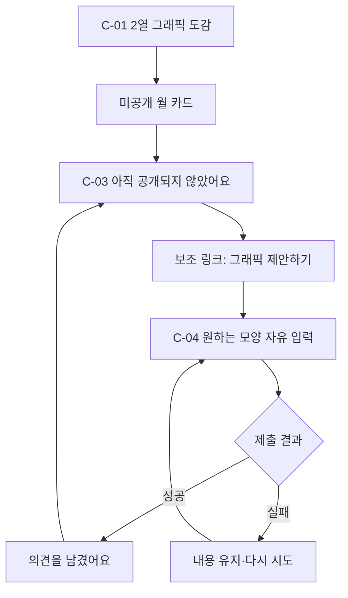
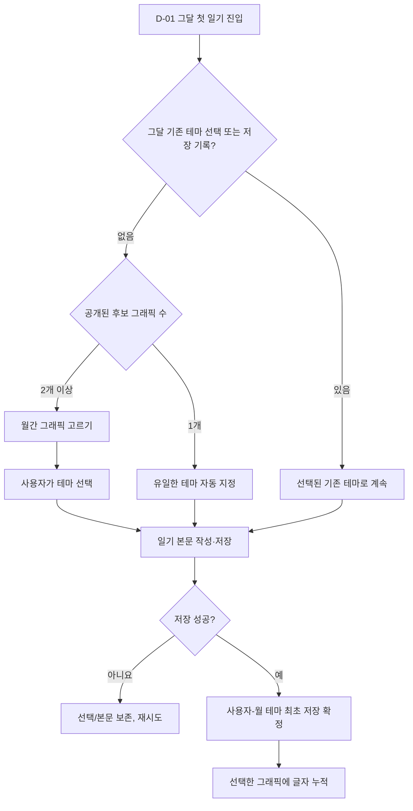

# 월별 그래픽 복수 선택 및 그래픽 아이디어 제안 — 확장설계 v1.3

> **확정된 제품 방향:** 미공개 그래픽에 대해 원하는 형태를 제안받되 낮은 위계로 제공. 장기적으로 같은 달에도 여러 그래픽 중 해당 월 첫 일기 때 선택 가능한 구조를 고려. **2026-12/2027-01 MVP에는 각각 한 그래픽만 있으며 선택 화면이 없다.**

## 1. MVP와 미래 확장 비교
| 상황 | 테마 후보 개수 | 사용자 경험 | 상태 |
|---|---:|---|---|
| 2026-12 | 1 | 눈꽃 자동 지정 | 확정 |
| 2027-01 | 1 | 붉은 양과 해 자동 지정 | 확정 |
| 2027-02 이후 | 미공개 | 잠금 상세에서 원하는 그래픽 아이디어 제안 | 제안 기능 확정, 구체 UI 제안 |
| 향후 특정 월 | 2개 이상 | 첫 일기를 쓸 때 그 달의 그래픽 선택 | 확장 방향 확정, 세부 UX 제안 |

## 2. 미공개 그래픽 아이디어 제출 플로우


### C-03
- 상단 월 + 잠금 / 미공개 안내, 도감으로 돌아가기.
- 최하단 보조 텍스트 액션: ‘이런 그래픽은 어때요? 의견 남기기’ (카피 잠정).
- 내부 데이터, 심사, 투표 수, 공개일 불확실성은 노출하지 않음.

### C-04
- 헤더 ‘그래픽 아이디어 남기기’, 본문 ‘어떤 모양의 그래픽이 좋을까요?’.
- 선택한 미래 월을 자동으로 연결. 입력란에 모양 묘사만 요청(예: 별자리·벚꽃나무); 별도 이름/연락처 요구하지 않음.
- 입력 공백 검증, 중복 제출 방지, 실패 시 원문 보존. 100~300자 등의 길이 제한은 제안/미확정.
- 저장 후 해당 아이디어를 다른 사용자에게 자동 공개하지 않음 [운영 제안].
- CTA 위계: 보내기(폼 내 주요), 화면에 진입하는 아이디어 링크 자체는 C-03의 낮은 위계.

## 3. 향후 월별 복수 그래픽 선택


- 테마 선택 시점은 첫 일기 **작성 경험 중**이다. 구체적으로 입력 전/저장 직전은 사용자 확인이 필요한 UX 상세 [제안].
- 사용자는 달마다 하나의 테마를 갖는다. 다른 달은 별도의 선택 가능.
- 신규 일기가 다른 월(예: 1월 1일에 12월 31일 작성)로 귀속되면 **그 기록의 `entry_date`에 해당하는 월의 선택 테마**를 사용.
- 첫 저장 실패 시 사용자가 본문 및 선택을 잃지 않음.
- 첫 저장 이후 변경 가능 여부(실수한 경우 교체 등)는 별도 정책 결정 필요.
- 새로운 후보가 나중에 추가돼도 과거 사용자의 선택을 소급해서 덮어쓰지 않는다.

## 4. 데이터 모델 [제안]
```ts
interface MonthCatalog {
  yearMonth: string;       // YYYY-MM
  targetDays: number;      // 12월은 출시일에 따라 아직 미확정
  status: 'current' | 'future_locked' | 'available' | 'archived';
}
interface ThemeOption {
  themeId: string;         // e.g. snowflake_2026 / red_sheep_sun_2027
  yearMonth: string;       // 같은 달 여러 themeId 허용
  assetVersion: string;
  availability: 'available' | 'locked' | 'hidden';
  renderConfig: object;
}
interface UserMonthGraphicSelection {
  userId: string;
  yearMonth: string;       // UNIQUE(userId, yearMonth)
  themeId: string;         // that month’s offered theme
  selectedAt: string;
  assetVersion: string;
  renderSeed: string;
}
interface GraphicIdea {
  id: string;
  userId?: string;
  targetYearMonth: string;
  suggestionText: string;
  createdAt: string;
  status: 'received' | 'reviewing' | 'closed'; // 내부 전용
}
```

## 5. 우선순위 및 보류 항목
- **필수 지금:** 월-테마-사용자 선택 관계를 데이터 모델에서 분리하고 1종 자동 지정 테스트.
- **작은 별도 기능:** 잠긴 월 → 제안 입력 → 서버 저장/피드백.
- **아직 만들지 않음:** 복수 후보 선택 UI, 재선택·재편집, 테마 투표, 제안 공개 커뮤니티.
- 보류: 피드백 길이/횟수·운영 모더레이션·로그 방침·기기별 UI, 첫 기록 삭제 시 선택 유지 여부.
