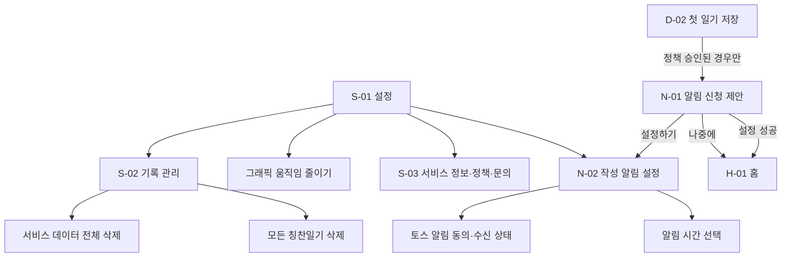

# 칭찬일기 — S-01 설정 · N-01/N-02 알림 · S-02 기록 관리

- 버전: v1.5 · 기준일: 2026-11-21 KST
- 상태 구분: **[확정]** 사용자 명시, **[제안]** 기획 추천, **[정책 검증 필요]** 플랫폼 승인/SDK 문서·실기기 확인 필요
- 설계 목표: 낮은 탐색 부담, 결과를 예측할 수 있는 설정, 불필요한 아이콘·카드·개발 용어 제외.

## 1. IA

## 2. S-01 설정 — 정보 구조 [제안]

**헤더:** ‘설정’. 독립적인 장식 일러스트, 거대한 안내 문구, 항목별 의미 없는 아이콘 배제.

| 구역 | 보이는 항목 | 상호작용 | 조건 |
|---|---|---|---|
| 알림 | 칭찬일기 알림 / 현재 상태(예: 매일 오후 9:00, 꺼짐) | N-02 | 기능성 알림 정책 승인 시 활성화. 미승인 상태에는 오해를 주는 작동 스위치를 노출하지 않음 |
| 그래픽 | 움직임 줄이기 | 전환 | 실기기 및 접근성 검토 후 제공 권장 |
| 내 기록 | 기록 관리 | S-02 | 항상 |
| 서비스 | 이용 안내 | S-03 | 항상 |
| 서비스 | 개인정보처리방침 / 이용약관 / 문의하기 | 공인된 경로로 연결 | 실제 게시 및 심사 요구사항 반영 |
| 부가 | 앱 정보(버전) | 정보 표시 | 필요할 때만 |

**레이아웃 제안:** 1열 목록, 섹션 헤더·구분선, 현재 상태의 보조 라벨. 화면 내 주요 CTA 남발 금지. 토스 상단 공통 내비게이션과 자체 뒤로가기 중복 금지.

## 3. N-01 첫 작성 이후 알림 제안 [사용자 목적 확정 / 구현 정책 검증 필요]

- 최초 일기 저장 성공 및 그래픽 성장 연출을 감상한 다음에만 제안.
- 설명 예시: “원하는 시간에 칭찬할 일을 떠올릴 수 있도록 알려드릴까요?”
- 액션: ‘시간 정하기’ / ‘나중에’.
- 거절해도 서비스 이용 방해하지 않음. 추후 S-01에서 변경 가능.
- 기능성 메시지 정책에 부합하지 않거나 메시지 템플릿이 승인되지 않으면 **동의 요청을 하지 않고 이 화면도 숨김**.

## 4. N-02 알림 설정 — 상세 상태 [제안]

| 상태 | UI 표현 | 허용 행동 | 저장·발송 동작 |
|---|---|---|---|
| NOT_CONFIGURED | 알림 꺼짐 | 시간 정하기 | 유효한 설정 후 SDK 동의 요청 |
| CONSENT_PENDING | 동의 절차 진행 | 동의 결과 대기 | 예약 발송 전환 금지 |
| ACTIVE | 알림 켜짐 · 선택된 시간 | 시간 바꾸기, 알림 끄기 | 서버 스케줄 동기화 |
| DECLINED | 신청하지 않음 | 다시 설정하기 | 알림 발송 없음 |
| PAUSED | 잠시 꺼둠 | 다시 켜기/시간 변경 | 알림 발송 없음 |
| DEVICE_BLOCKED/UNKNOWN | 수신 상태 확인 필요 | 토스 알림 설정 확인 방법 안내 | 수신 가능으로 단정 금지 |
| POLICY_UNAVAILABLE | 알림 제공 불가 | 기능 설명만 또는 UI 숨김 | 발송 없음 |

**시간 선택 [제안]:** 기본 추천 `아침 08:00`, `저녁 18:30`, `하루 마무리 21:00`; `직접 설정`으로 HH:mm 지정 지원. 출퇴근이 모두에게 적용되는 일과는 아니므로 중립적 명칭. 설정 저장 전에 사용자에게 선택한 정확한 시각을 보여주기.

**서비스 날짜 규칙 [확정 · v1.6 변경]:** 기본 하루 경계는 KST 00:00(자정), 사용자가 설정에서 변경 가능. 알림의 작성 여부 판단도 사용자별 경계 설정에 따른다. 사용자가 경계를 03:00으로 설정한 경우 00:00–02:59의 작성은 전날에 속한다. 사용자에게 날짜가 필요한 순간에는 실제 귀속일을 명확히 표시.

**발송 제어 [제안]:** 선택한 시각에 이미 해당 서비스 날짜의 일기가 하나 이상 있으면 발송 생략. 작성하지 않은 경우 최대 서비스 날짜당 1회. 예약·발송 중복은 원자적으로 제어. 이용자가 끄면 즉시 내부 발송 비활성화. 스케줄 재설정 시 당일 중복 발송 방지. 알림 클릭 → D-01 작성 화면, 유효한 사용자 식별·날짜 정책 적용. 초안이 있으면 복원 확인이 먼저.

**수신 동의 [공식 정책]:** 앱인토스 콘솔에서 승인받은 템플릿을 기준으로 제공 SDK 알림동의 UI 사용. `Notification.requestAgreement` (함수형 별칭 `requestNotificationAgreement`) 지원 여부·응답(`newAgreement`, `alreadyAgreed`, `agreementRejected`) 처리. 자체 제작한 동의 토글이 토스의 동의를 대체한다고 표현하지 않음. 앱 내부 알림 켜기/끄기와 토스 앱의 서비스별 알림 수신 설정을 구분. 토스 설정에서 차단된 경우, SDK로 조회·변경 가능한 범위는 구현 전에 확인.

**심사·발송 주의:** 정기적인 ‘일기 쓰러 오세요’ 메시지는 단순 재방문 유도로 분류될 수 있어 **기능성 메시지 인정 여부 별도 확인이 필수**. 콘솔 정기 발송이 된다는 사실은 개인별 오늘 작성 여부에 따른 발송 제어가 자동 가능함을 뜻하지 않음. 대량 발송은 21:00–08:00 제한이 있어 개인별 시간 설정·발송 방식은 기술 검증 필요.

## 5. S-02 기록 관리와 삭제 [핵심 데이터 영향 명확화]

### A. 모든 칭찬일기 삭제 [제안]
- 삭제 요청 전 **일기 모두 삭제**, **이에 따라 도감 그래픽이 빈 상태로 변경**, **복구 불가**를 명확히 안내.
- 이전에 꺼내보기를 10개로 열었다면 **영구 해제 상태는 그대로 유지**. 기록이 0개가 되면 잠금이 아닌 ‘꺼낼 칭찬이 없어요’ 빈 화면으로 이동.
- DiaryEntries 유효 기록, 그래픽 계산 캐시, 추첨 이력, 임시기록 등 종속 데이터의 정리 정책 필요. 사용자가 원하는 삭제 범위(임시기록 포함)는 출시 전 확정.

### B. 서비스 데이터 전체 삭제/초기화 [제안]
- 일기·도감 데이터·임시기록·알림 선호·꺼내보기 해제 이력 등을 포함해 서비스 내 모든 연결 데이터를 삭제.
- 이후 같은 토스 사용자 식별키로 재진입하더라도 새 이용자 상태로 초기화되는 처리 정의.
- 알림 발송 중지 및 외부 동의/수신 상태 정리 안내 필요. 실제 법적 보존 의무·백업·로그 보관 및 삭제 완료 기준 별도 검증.
- 위험 작업은 화면 하단 낮은 위계로 배치. 실수 방지용 명시적 확인 다이얼로그 + 중복 요청 방지 + 서버 성공 확인 후 완료 문구 표시. 2개 삭제 기능이 과도하면 단일 '서비스 데이터 삭제' 메뉴로 축소할지 검토.

## 6. S-03 정보·문의 [제안]
- '이 앱은 어떤 앱인가요?' 짧은 이용 안내: 월별 그래픽/꺼내보기/도감의 이용 방법.
- 개인정보처리방침/서비스 약관은 유효한 실제 URL만 연결.
- 문의하기는 공식 제공 경로 또는 운영 가능한 문의 수단으로 연결. 임의 주소 작성 금지.
- 팀 소개나 홍보성 콘텐츠는 굳이 추가하지 않음.

## 7. 화면·데이터·연결 매핑

| 화면 ID | 필수 데이터 | 진입 → 이동 |
|---|---|---|
| S-01 | `reminder_state?`, `reminder_time?`, `reduce_motion`, `app_version` | H-01 → N-02/S-02/S-03 |
| N-01 | `first_entry_saved`, `onboarding_reminder_asked`, `feature_flag` | D-02 → N-02/H-01 |
| N-02 | `preferred_time`, `timezone`, `consent_state`, `local_enabled`, `last_sent_service_date` | S-01/N-01 → S-01 |
| S-02 | `entry_count`, `unlock_history`, deletion status | S-01 → 확인 → S-01/온보딩 |
| S-03 | 게시된 이용약관/정책 링크·문의 경로 | S-01 → 외부 안내/복귀 |

**DB/백엔드 제안:** `ReminderPreferences(user_id, preferred_local_time, timezone, local_enabled, consent_template_code, consent_state, consent_updated_at, last_sent_service_date, updated_at)`; `UserPreferences(user_id, reduce_motion, ...)`; 요청 로그에는 개인 일기 원문·민감한 텍스트 기록 금지.

## 8. 예외 및 QA

- 사용자 거절/미동의/미지원 버전/정책 미승인/토스 알림 차단 상태에서 발송 금지.
- 시각 변경 저장 실패 시 기존 일정 유지·화면에 저장 실패 표시.
- 푸시 동의 도중 앱 종료 시 동의 상태 재조회 또는 확인 후 재시도; 중복 발송 금지.
- 같은 서비스 날짜에 작성 완료하면 당일 미작성 리마인더 발송 생략.
- 기본 자정 23:59→00:00, 사용자 설정 02:59→03:00, 연말 경계, 지정 01:00 리마인더의 귀속 날짜 검증.
- 21:00–08:00 야간 발송 제약 확인(단건/대량 방식별 차이).
- 모든 일기 삭제 후 그래픽·도감 초기 상태와 꺼내보기 해제 상태 일치.
- 서비스 데이터 전체 삭제 이후 알림·해제 이력까지 제거.
- 접근성: 시스템 글씨 크기 대응, 레이블과 컨트롤 연관, 화면 읽기 순서, 색상만으로 상태 알리지 않기, 줄이기 모드 적용.
- 기능성 알림이 승인되지 않아도 글쓰기/그래픽/꺼내보기/도감/기록 삭제는 정상 사용 가능.

## 9. 보류/판단 필요

1. **[정책 검증 필요]** '사용자 지정 시각 칭찬일기 작성 리마인더'의 기능성 푸시 허용 여부와 승인할 문구.
2. **[기술 검증 필요]** 사용자별 정기 발송 + 작성 여부 검사 + 사용자별 날짜 경계(기본 자정) 처리 방식 및 야간 발송 경로.
3. **[보류]** 사용자 시간 직접 설정 범위(권장 전 시간 허용), 시간대/해외 사용자 정책.
4. **[보류]** 앱 내 알림 일시정지 vs 수신동의 철회 UI 구분 및 SDK 지원 범위.
5. **[보류]** 삭제 메뉴 한 개 vs 두 개, 기기/서버/백업에서의 삭제 범위.
6. **[보류]** 움직임 줄이기 기본값 및 OS 접근성 설정 연동.

## 공식 근거·외부 참고 (2026-11-21 확인)

- [앱인토스 2026-10-15 로그인·알림 동의 시점](https://toss.im/apps-in-toss/blog/mini-app-login-notification-timing)
- [앱인토스 푸시알림 가이드](https://developers-apps-in-toss.toss.im/guide/marketing/smart-message)
- [Notification.requestAgreement API](https://developers-apps-in-toss.toss.im/documentation/sdk/domains-api/notification/notification.requestagreement)
- [2026-11-10 기능성 메시지 범위 관련 공식 커뮤니티 답변](https://techchat-apps-in-toss.toss.im/t/topic/5173)

## 10. v1.5 업데이트

- **[사용자 확정]** 모든 칭찬일기 삭제에 다단계 확인 필요. [제안] 영향 안내 → ‘모든 기록 삭제’ 직접 입력 → 마지막 확인 → 서버 응답 검증. 닉네임 입력은 향후 계정 닉네임이 존재할 때 고려. 자세한 내용 `11_전체기록삭제_보호절차.md`.
- **[UX Writing 개선 제안]** N-01 ‘하루를 돌아볼 시간을 정해둘까요?’, 설명 ‘원하는 시간에 칭찬일기를 떠올릴 수 있도록 알려드려요. 이미 칭찬을 남긴 날에는 보내지 않아요.’, CTA ‘알림 시간 정하기’ / ‘나중에’. N-02 ‘언제 알려드릴까요?’, 설정 실패 ‘시간을 변경하지 못했어요. 다시 시도해 주세요.’
- **[정책 검증]** 기능성 메시지 승인 전에는 첫 저장 알림 제안/시간 피커/설정 토글/실제 푸시 미노출. 기존 오후 9시 기본 추천은 대량 야간 제한과 충돌하므로 오후 8시 30분을 [제안] 후보로 변경. 예약·발송 방식 최종 검증 필요.
- **출처 및 상세:** `10_알림_공통_UX라이팅.md` 및 앱인토스 공식 푸시알림 가이드.

## v1.6 추가: S-01 '하루가 바뀌는 시간' [확정]
- 알림 설정과는 다른 독립 메뉴. 기본은 오전 12시(자정)이며, 사용자가 경계 시각을 변경할 수 있다.
- [제안] 0·1·2·3·4시 정각 선택. 예시 설명 ‘밤 12시부터 오전 3시 전까지 작성한 일기는 전날로 기록돼요.’
- 설정 변경 시 ‘앞으로 쓰는 일기부터 적용돼요. 이미 쓴 일기의 날짜는 바뀌지 않아요.’ 안내.
- 날짜 경계 변경은 저장된 `entry_date`를 소급 수정하지 않음. 작성 중 초안의 날짜 역시 자동 변경하지 않음.
- 알림이 승인되어 제공되면 해당 사용자 기준일을 기준으로 작성 여부를 점검. 알림 자체는 승인 전까지 화면에서 비노출.
