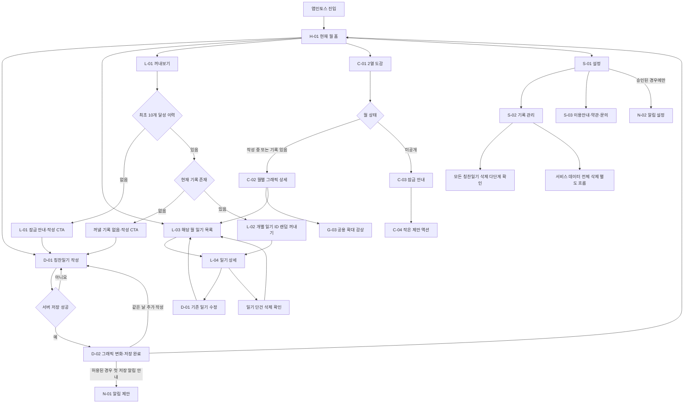

# 칭찬일기 — 통합 IA 및 전체 서비스 플로우 감사 v1.6

> 기준: 2026-11-21, 기존 01~08 명세와 이 대화의 사용자 결정. 확정·제안·외부 검증을 엄격히 분리. 본 문서는 **IA 통합 검토 결과**이며 새 기능의 자동 승인 문서는 아님.

## 1. 불변 제품 원칙 [확정]

1. **중심 경험:** 칭찬일기 작성 → 글자 파티클이 월별 그래픽에 누적 → 시간이 흐른 후 직접 쓴 일기를 랜덤 재발견.
2. **기록일 vs 일기 수:** 같은 서비스 날짜에 여러 편 기록 가능. 그래픽 성장 높이는 유효한 `entry_date`의 서로 다른 날짜 수; 추가 일기는 글자만 증가. 2027-01 정규 목표 15일, 2026-12 목표 보류.
3. **서비스 날짜:** 기본 KST 00:00(자정), 사용자 설정으로 경계 변경 가능. 신규 작성 시 기본 오늘·선택 어제, 작성 시 정확한 기록 날짜 표시. 작성 중 사용자별 경계가 지나도 날짜와 본문 유지·저장 유예; 유예 기한 미확정.
4. **작성:** 서로 다른 내부 유형에서 회고 질문 2개; 선택하지 않아도 자유 작성 가능. 내부 유형·기술적 상태 코드 노출 금지.
5. **그래픽:** 2026-12 눈꽃, 2027-01 붉은 양·해. 그래픽은 아래→위로 자라고 삭제 시 상황별 줄어듦. 과거 완성·미완성 모두 도감에 보관하며 변경 사항 반영.
6. **꺼내보기:** 개별 일기 10편 최초 달성 시 **영구 해제**; 같은 날짜의 일기도 각각 추첨 후보. 이후 삭제로 10편 미만이 되어도 재잠금하지 않음. 기록이 0개면 빈 상태.
7. **도감:** 2열 카드, 미공개 미래 월 제안 기능은 낮은 UI 위계. 향후 동일 월 복수 그래픽 중 첫 일기 작성 시 선택 가능하도록 자료 구조 준비.
8. **안전:** 삭제 시 기록·그래픽 영향 고지. **모든 칭찬일기 삭제는 여러 단계 확인**. 과장된 죄책감 유발 문구 금지.
9. **디자인:** 그래픽은 주인공, 조작 UI는 최소. 반복되는 무의미한 아이콘·장식 카드·그라데이션 배제. 사용자에게 필요 없는 정보는 UI에서 숨김.
10. **알림:** 사용자 선택적 발송 의도는 유지하되 앱인토스 정책 승인 전 알림 신청·동의 UI 및 발송 OFF.

## 2. 통합 IA — 권장안 [제안]

**탭 구조 [제안/미확정]:** 하단 '홈·꺼내보기·도감' 3탭 + 홈 상단의 '설정' 진입이 단순할 수 있음. 기존 4탭(설정 포함)도 후보. TDS 사용성 검증 전 확정하지 않음. 상단·하단에 설정 중복 진입점을 만들지 않음. 기록 관리(S-02)는 꺼내보기 잠금과 무관하게 접근 가능해야 함.

## 3. 화면 인벤토리: 통합·삭제·재사용

| ID | 목적 | 판단 | 주요 연결 |
|---|---|---|---|
| O-01 | 처음 사용 안내 | MVP에서는 최소 안내 제안 | H-01 |
| O-02 | 필수 안내·동의 | 실제 법적 요건 확인 전 가짜 동의 플로우 생성 금지 | H-01 |
| H-01 | 현재 월 홈 및 큰 그래픽 | 유지; 전체 기록 보기 진입점 추가 | D-01, G-03, L-03, C-01, L-01, S-01 |
| H-02 | 월 선택 | **통합 제안:** C-01 도감이 월 탐색 담당 | C-01 |
| H-03 | 잠긴 월 안내 | **중복 제거 제안:** C-03과 통합 | C-03 |
| D-01 | 신규·기존 기록 수정 | 유지, 진입 모드·편집 제한 분리 | D-02 또는 기록 상세 |
| D-02 | 저장 확인+성장·추가·완성 모션 | 유지 | 홈/작성/그래픽 |
| G-01 | 15일 최초 완성 | **별도 페이지가 아닌 D-02의 completion 변형** 제안 | D-02 |
| G-02 | 지난달 그래픽 상세 | **C-02에 통합** 제안 | C-02 |
| G-03 | 큰 그래픽 뷰어 | 공용 컴포넌트 유지 | H-01/C-02 |
| L-01-LOCK | 10개 미달 시 꺼내보기 안내 | 유지 | D-01 |
| L-01 | 잠금 해제 후 꺼내보기 홈 | 유지 | L-02/L-03 |
| L-02 | 랜덤 일기 한 편 원문 | 유지 | 다시 뽑기/L-04 |
| L-03 | 전체·월별 일기 목록 | **꺼내보기 잠금과 무관한 접근 확정** | H-01, C-02, L-01(해제 시), L-04 |
| L-04 | 일기 상세·수정·삭제 | 유지 | D-01, L-03 |
| C-01 | 도감 2열 월별 카드 | 유지 | C-02/C-03 |
| C-02 | 월별 큰 그래픽·월별 기록 링크 | 유지 | G-03/L-03 |
| C-03 | 아직 공개되지 않은 월 | 유지 | C-04 |
| C-04 | 그래픽 제안하기 | 보조 기능 유지, 출시 우선순위 낮음 | C-03 |
| S-01 | 설정 | 유지 | N-02/S-02/S-03 |
| S-02 | 삭제·기록 관리 | 유지 + 다단계 삭제 확인 | S-01 |
| S-03 | 이용 안내·정책·문의 | 유지 | S-01 |
| N-01/N-02 | 알림 신청·설정 | **정책 미승인 시 UI 비노출** | D-02/S-01 |
| X-01 | 로딩·실패·오프라인·복원 안내 | 공통 상태 컴포넌트로 통일 | 각 원래 화면 |

## 4. 핵심 사용자 여정 9개 — 통합 검토

| # | 여정 | 기대 결과 | 종합 |
|---|---|---|---|
| J1 | 처음 진입 → 질문 건너뛰기 → 첫 일기 저장 | 당일 인정 1일 증가·첫 성장 연출 | 연결됨 |
| J2 | 같은 날 두 번째 일기 | 일기 2편·인정 1일·글자만 추가 | 연결됨 |
| J3 | 아직 10편 미만 → 꺼내보기 | 설명+작성 CTA, 랜덤 미노출 | 연결됨 |
| J4 | 열 번째 일기 저장 → 꺼내보기 | 해제 이력 저장·각 일기 독립 후보 | 연결됨(해제 최초 축하 카피는 제안) |
| J5 | 10편 후 삭제로 9편·0편 | 영구 해제 유지, 0편 시 빈 상태 | 연결됨 |
| J6 | 도감 과거 미완성/완성 → 그달 글 목록 → 수정/삭제 | 그래픽·인정일·꺼내보기 후보 갱신 | 연결됨(공용 L-03 필요) |
| J7 | 1/1 01:00 등 월경계 → 오늘/어제 작성 | 자정 기본이면 1/1로 기록, 사용자 경계 03:00이면 12/31 표시 | **정책 수정 완료**: 사용자별 설정 및 실제 저장 날짜 안내 |
| J8 | 사용자별 하루 경계 넘겨 작성 지속·저장 | 기존 날짜/초안 유지, 유예 범위 내 저장 | **유예 종료 기한 미확정** |
| J9 | 모든 일기 삭제 → 0편 → 재방문 | 안전 확인 후 모두 삭제, 꺼내보기 해제 이력만 유지 | 삭제 상세 명세와 서버 정합성 필요 |

## 5. 충돌 및 누락 감사 — 우선순위

### P0 · 구현 전 필수 해결

1. **2026-12 목표**: 출시일에 따라 15일 목표 달성 불가능. 단축 목표 또는 특별판, 목표 설정 방식 결정 필요.
2. **[MVP에서 제거] 미래 미공개 월 작성 플로우:** 미래 일기는 오늘·어제 제한상 작성 불가. 해당 월 시작 전 필요한 그래픽을 제작·배포할 운영 리스크로 이관.
3. **[정책 변경으로 해결]** 기본 KST 00:00, 사용자별 변경 가능. 1/1 01:00 기본 설정은 1/1 기록, 경계를 03:00으로 바꾼 사용자는 12/31 기록으로 표시. 선택 날짜 확인 및 작성 중 유예 검증은 남음.
4. **연속 기록 안전성**: 신규·수정 모드 및 사용자별 서비스 날짜 유예·임시저장 복원의 서버 검증을 명확하게 정의. 날짜 경계에서 초안 유실 금지.
5. **개인 기록 접근 보안**: 서비스 식별키/서버 사용자 권한/로그/그래픽 원문 노출을 포함해 본인 일기만 조회·수정·삭제·랜덤 추첨 가능하도록 구성.
6. **알림 정책**: 기능성 심사 전 재방문 리마인더를 허용된 것으로 전제하지 않음. 출시 필수 흐름에서 제외·플래그 처리.
7. **[정책 확정] 일기 목록 권한/접근**: 꺼내보기 잠금과 전체 일기 조회·수정/삭제를 분리. H-01 → L-03 직접 진입 및 C-02 → L-03 월별 진입 보장.

### P1 · 시각 설계 전 결정·검증

1. H-02 vs C-01, H-03 vs C-03, G-01 vs D-02, G-02 vs C-02 중복을 정리해 최종 화면 ID 확정.
2. 편집된 글자 렌더·삭제된 마지막 글자·복수 일기 랜덤 후보와 도감 카드 revision 일치 테스트.
3. 제목 입력/500자 제한/서버 임시저장 보관 기간 및 복원 UX 확정.
4. 하단 탭 3개(+설정 별도) vs 4개 비교 및 홈에서 접근 가능한 빈 달/내 기록 링크.
5. 첫 10편 달성 시 잠금 해제 피드백 위치(기본 그래픽 성장 연출 방해 금지).
6. 한 달 복수 테마 중 처음 선택 후 첫 기록 삭제 시 선택 보존/변경 여부.
7. 미래 그래픽 아이디어 제출 시 텍스트 정제·욕설/개인정보·스팸 방지, 운영자 수신 흐름.
8. 데이터 소거 범위: 개별 기록 삭제, 전체 칭찬일기 삭제, 서비스 사용자 데이터 완전 삭제를 구분.

### P2 · 출시 뒤 확장

- 그래픽 공유/내보내기, 3D 자유 회전 확대, 복수 월간 선택 UI, 알림 정책 승인 이후 개별 시간 예약.

## 6. 12개 핵심 QA 시나리오

1. 한 날짜 10편 기록 시 월간 인정 1일, 꺼내보기 해제.
2. 10편 해제 후 9편으로 삭제해도 잠김 표시 없음.
3. 10편 해제 후 0편 삭제하면 잠금 대신 작성 CTA가 있는 빈 상태.
4. 1일 작성 후 동일 날짜 추가하면 성장 높이 고정·글자만 추가.
5. 해당 날짜 마지막 기록 삭제하면 인정일 감소·월별 그래픽 축소.
6. 15→14일로 감소하면 완성 상태 변경 안내.
7. 2027-01-01 01:00 기본 경계(자정)이면 2027-01-01 표시; 경계를 03:00으로 변경한 계정은 2026-12-31 표시 및 03:00에 서비스 날짜 전환.
8. 02:59에 진입해 03:01에 저장하더라도 확정된 유예 정책과 입력 보존 적용.
9. 2027-01-01에 2026-12-31 일기 작성 시 12월 눈꽃·도감 재계산.
10. 꺼내보기 잠금 중에도 도감 해당 월에서 L-03 목록·L-04 수정/삭제 가능.
11. 저장 실패/애니메이션 실패에서 중복 기록 없이 원문·화면 보존.
12. 전체 삭제에서 영향 고지→문구 직접 입력→최종 확인을 거치지 않으면 삭제 API 실행 불가.

## 7. 최종 판단

**IA 자체를 구현 전 '완전 확정'으로 선언하기엔 빠름.** 일기 작성/모션/꺼내보기/도감/설정의 핵심 경로는 연결되었지만, P0 7개 중 월별 테마·서비스 날짜 정책·개인정보/알림 같은 출시 블로커가 남음. 특히 알림은 승인 전 출시 범위에서 제외하는 조건부 기능.

디자인시스템 착수 조건 제안: (1) 중복 화면 ID 통합 (2) 12월 목표는 출시일 이후 숫자 설정 [정책 완료] (3) 날짜 경계는 기본 자정 + 사용자 설정 [정책 완료] (4) 미래 월 기록 불가 [정책 완료] (5) 내 기록 접근 [정책 완료] (6) 유예 종료조건·보안·알림 승인·에셋 준비는 별도 검증. 나머지 고급 그래픽은 기술 스파이크 가능.

## v1.6 통합 검토 변경 기록
- **해결:** 기본 03:00 고정 → 기본 00:00 + 사용자 변경. 날짜 확인 카피 상시 표시 및 필요 시 토스트.
- **해결:** 미공개 미래 월 일기 작성 시나리오는 오늘·어제 제약으로 MVP에서 제거. 해당 월 시작 전 테마 제작은 운영 릴리스 요건.
- **해결:** 2026-12는 특별 목표를 적용하되 숫자는 출시일 확정 시 결정.
- **해결:** 홈 H-01에 독립적인 기록 보기 → L-03. 길게 누르기만으로는 접근하지 않음(접근성 보장).
- **미완결:** 유예 저장 시간·안전 복구, 비공개 데이터 권한, 알림 허용 여부, 최종 탭 구조, 12월 특별 목표의 숫자.
